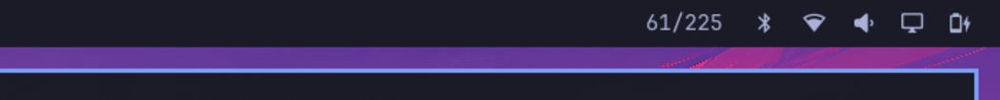

# AgentBI — Omarchy bar widget

One number in your bar: **how many of 225 storefronts an AI agent can actually buy from today.**

- Label: `61/225` — stores serving a UCP profile today, out of the scanned pool.
- Tooltip: run day, how many were reachable, average score, and how many let a real
  browser in but turn non-browser clients away.
- Left click opens the leaderboard, middle click refreshes.

## Install

    omarchy plugin add https://github.com/JamesChief/omarchy-plugin-agentbi --enable

Or clone it into `~/.config/omarchy/plugins/agentbi/` and `omarchy plugin enable agentbi`.

## Where the numbers come from

<https://agentbi.tech/summary.json> — a few hundred bytes, public, no API key, cached
30 minutes. Everything on the site is recomputable from the raw daily scan:
<https://agentbi.tech/batch.json> (one row per store, every measured field).

The census runs once a day (`03:30 +0800`), so the widget refreshes every 30 minutes
and not faster — there is nothing new to poll in between, and the data is a snapshot
from a single vantage, which the site states on every page.

## Privacy

No accounts, no telemetry. The only outbound request this widget makes is one `curl`
to the summary above (a plain GET, logged like any other visitor).
